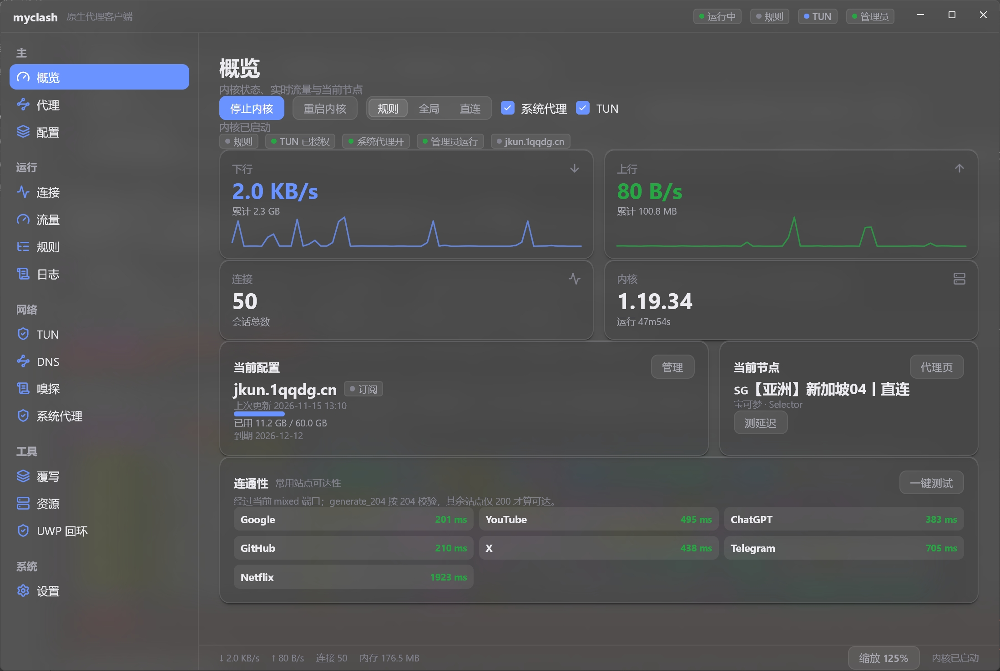

# myclash

> 一个用 Go 写的、尽量不折腾的 mihomo 桌面客户端。

[](https://github.com/zcg/myclash/actions/workflows/release.yml)
[](./LICENSE)

myclash 的界面框架是 [MyGo](https://github.com/egoist/mygo)，代理内核是
[mihomo](https://github.com/MetaCubeX/mihomo)，也就是“虚空终端”这一套思路：
用 Go 写原生桌面界面，把内核直接嵌进应用，不引入 Electron、WebView 和额外的
Rust/Tauri 进程。

感谢 MyGo、mihomo 和虚空终端的作者与贡献者。没有这些项目，这个客户端不会存在。

## 关于开发方式

这个项目是一次 AI vibe coding 的产物：从代码、文档到 CI，全程使用 **DeepSeek V4.1 flash**，通过编码代理完成。作者负责提需求、验收和不断挑毛病，AI 负责实现、重构、写文档和修 bug。

一句话：人负责 vibe，AI 负责 coding。

所以代码里可能还留着一些 AI 特有的过度设计、遗漏或者“看起来很合理但实际上很怪”的实现。欢迎 review、提 Issue 和 PR。

## 为什么做这个

作者长期使用 Clash Party，更新、配置覆盖、TUN、系统代理、订阅切换等各种报错
已经受够了。需求其实很简单：

- 打开就能用，不要每次更新都折腾配置
- 订阅、节点、规则、TUN、系统代理放在一个界面里
- 资源占用别太夸张，不要为了一个代理开一堆进程
- 主要配合自己白嫖的宝可梦机场使用，日常体验稳定就行

所以有了 myclash。它不是功能最全的 Clash 客户端，目标是把日常最常用的流程做顺。

## 平台兼容性

| 平台 | 状态 | 说明 |
| --- | --- | --- |
| Windows 10 1809+ / Windows 11 | **主要开发与实机测试** | x64 / arm64；TUN 需要管理员权限 |
| macOS 12+ | 理论可构建，**基本未实机测试** | universal（arm64 + x64）；使用 ad-hoc 签名 |
| Linux（glibc 2.28+、GTK 3） | 理论可构建，**基本未实机测试** | x64 / arm64；提供 tar.gz、deb、rpm、PKGBUILD |

作者日常只用 Windows，macOS 和 Linux 的安装包没有经过完整验收。CI 会把三端都
构建出来，但不代表三端都已经测试通过；遇到平台问题需要自行排查。

欢迎提交 Issue 和 PR。只要你愿意修，作者很乐意合并。



## 功能

- **订阅与配置**：订阅导入/更新、本地 mihomo YAML、配置切换
- **代理**：代理组、节点延迟/测速、节点切换、当前节点恢复
- **规则**：规则 / 全局 / 直连模式，规则与日志查看
- **TUN**：mips 栈，开启时自动提权，支持自动路由、DNS 劫持
- **系统代理**：手动代理与 PAC，支持绕过列表
- **覆写**：YAML 覆写与 JavaScript `main(config)` 脚本覆写（goja 沙箱）
- **网络工具**：DNS、Sniffer、连接列表、进程归属、实时速率
- **Windows 专属**：UWP 回环豁免（批量 UAC）
- **数据**：WebDAV 备份/恢复、日志保留策略、流量历史
- **体验**：命令面板、悬浮窗、托盘左键显示主窗口、通知、深浅色
- **外观**：液态玻璃 / 透明 / 实色三种预设，适配系统材质
- **更新**：基于 MyGo Updater 的 GitHub Release 检查与安装
- **i18n**：简体中文 / English / 跟随系统

## 下载与安装

从 [GitHub Releases](https://github.com/zcg/myclash/releases) 下载对应平台的包。

### Windows

优先使用：

```text
myclash-setup-<version>-amd64.exe
```

也可以直接运行便携版 `myclash.exe`。

安装包没有购买代码签名证书，Windows SmartScreen 可能提示“未知发布者”：
选择“更多信息” → “仍要运行”即可。TUN 模式需要管理员权限。

### macOS

```text
myclash-<version>-universal.dmg
```

当前使用 ad-hoc 签名，没有 Apple Developer ID 公证。首次打开如果被 Gatekeeper
拦截，可以在“系统设置 → 隐私与安全性”里允许，或执行：

```bash
xattr -dr com.apple.quarantine /Applications/myclash.app
```

### Linux

提供：

```text
myclash-<version>-linux-amd64.tar.gz
myclash-<version>-linux-arm64.tar.gz
myclash_<version>_amd64.deb
myclash-<version>-1.x86_64.rpm
PKGBUILD
```

优先使用发行版对应的包。Linux 桌面环境需要 GTK 3。

## 快速开始

1. 打开「订阅」，添加订阅链接或导入本地 mihomo YAML
2. 选中配置，等待内核启动
3. 到「代理」选择节点或代理组
4. 到「系统代理」开启系统代理，或在「TUN」开启 TUN
5. 首页「连通性」可以测试常用站点；只有目标期望的状态码才算可达

> 本项目的连通性测试中，`generate_204` 探测地址按 204 校验，其余站点按 200
> 校验。这样做是因为 Google / YouTube 的 `generate_204` 正常返回就是 204，
> 不是放宽成“只要小于 500 就算成功”。

## 从源码构建

需要 Go **1.27+**。项目使用 MyGo 的构建命令，不需要 Node.js。

```bash
go install github.com/egoist/mygo/cmd/mygo@v0.9.1

# 当前平台
mygo build

# 指定平台
mygo build -platform windows/amd64,windows/arm64
mygo build -platform darwin/universal
mygo build -platform linux/amd64,linux/arm64
```

构建产物在 `build/`（或用 `-o` 指定目录）。在 Windows 上构建安装包时，MyGo
会自动下载 NSIS；也可以提前安装 NSIS。macOS 的 DMG 和签名需要在 macOS 上构建。

开发模式：

```bash
mygo dev
```

## CI 与发布

发布流水线在 [`.github/workflows/release.yml`](./.github/workflows/release.yml)。

支持两种触发方式：

1. **打 Tag**：Tag 必须与 `mygo.json` 的版本一致，例如版本是 `0.12.4`：

   ```bash
   git tag v0.12.4
   git push origin v0.12.4
   ```

2. **修改版本号**：只修改 `mygo.json` 的 `version` 并推送到 `main`，CI 会检测到
   版本变化并自动构建、创建 Release。

流水线会构建：

- Windows x64 / arm64：便携 exe + NSIS 安装包
- macOS universal：`.dmg`（构建产物中也包含 `.app`）
- Linux x64 / arm64：tar.gz + deb + rpm + PKGBUILD

所有产物会统一上传到对应的 GitHub Release。

可选配置仓库 Secret：

```text
MYGO_UPDATER_PRIVATE_KEY
```

配置后 MyGo 会生成签名更新包；不配置也能正常构建安装包，但自动更新的更新包没有
签名，发布前请自行确认更新策略。

## 已知限制

- macOS / Linux 未做完整实机验收，遇到问题需要自行排查或提 PR
- Windows 安装包没有商业代码签名，SmartScreen 会提示未知发布者
- TUN 需要管理员权限；UAC 被拒绝时 TUN 不会生效
- 本项目只保留标准单进程模式，不再提供轻量模式
- English 翻译尚未覆盖所有页面文案

## 技术栈

- Go 1.27
- [MyGo](https://github.com/egoist/mygo)：原生 UI、窗口、托盘、菜单、通知、更新
- [mihomo](https://github.com/MetaCubeX/mihomo)：代理内核
- [goja](https://github.com/dop251/goja)：JavaScript 覆写沙箱
- [yaml.v3](https://gopkg.in/yaml.v3)：配置读写

## 许可证

GPL-3.0。由于内嵌 mihomo，本项目必须使用 GPL-3.0 分发。完整文本见
[LICENSE](./LICENSE)，第三方组件说明见 [NOTICE](./NOTICE)。

## 致谢

- [MyGo](https://github.com/egoist/mygo)
- [mihomo](https://github.com/MetaCubeX/mihomo)
- 虚空终端
- 所有提交 Issue、测试和 PR 的人
